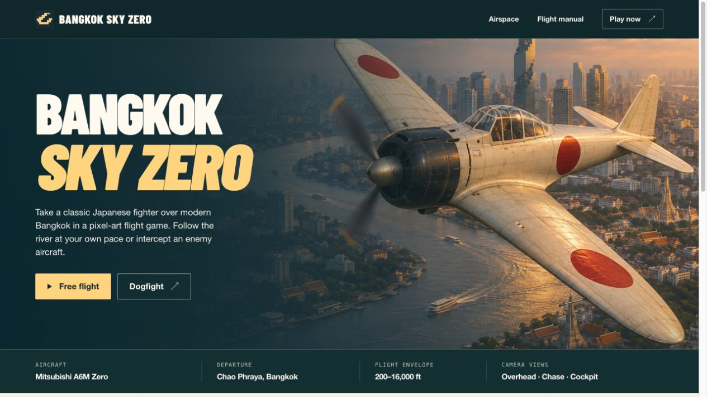

# Bangkok Sky Zero

Fly a Mitsubishi A6M Zero over a pixel-art version of modern Bangkok. Follow the Chao Phraya past ICONSIAM, explore the outskirts in free flight, or take on an opposing fighter.

[Play Bangkok Sky Zero](https://pond1982.github.io/bangkok-sky-zero/)

## Run locally

Open `index.html` in a browser to visit the game’s home page, or open `outputs/pelagic.html` to play the standalone game. Both run from static files. The game includes keyboard, pointer, and touch controls.

## GitHub Pages

GitHub Pages publishes the root of the `main` branch. The landing page lives in `index.html`, with its styles in `site.css` and artwork in `assets/`. The simulator’s code and graphics are contained in `outputs/pelagic.html`.
